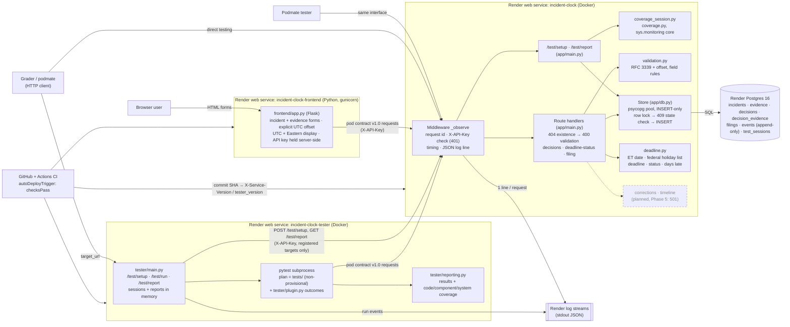
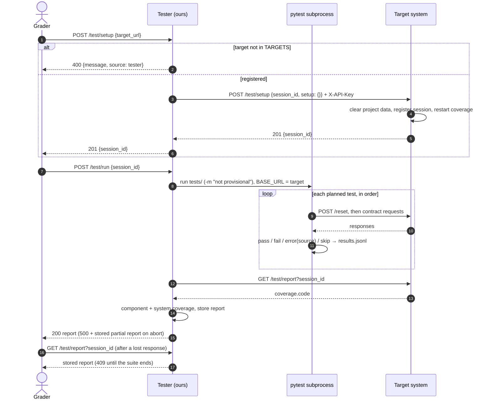
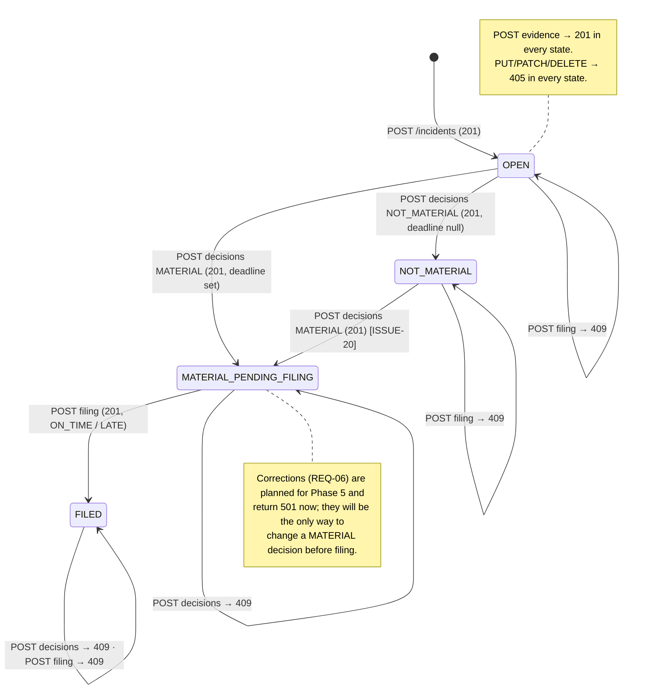
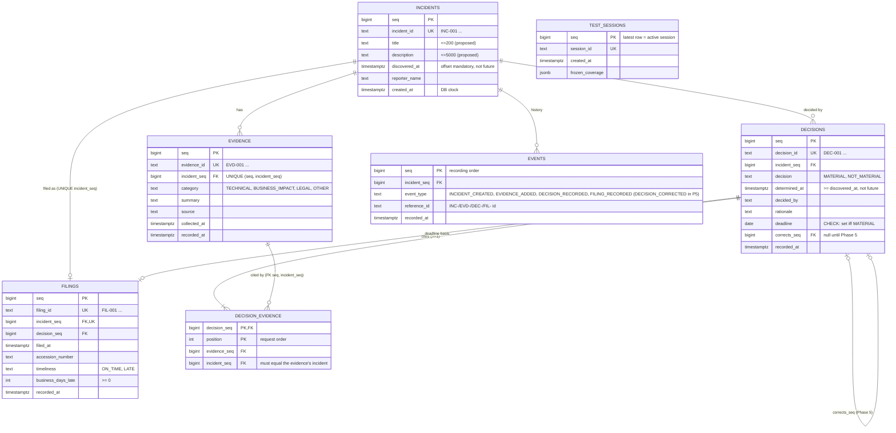
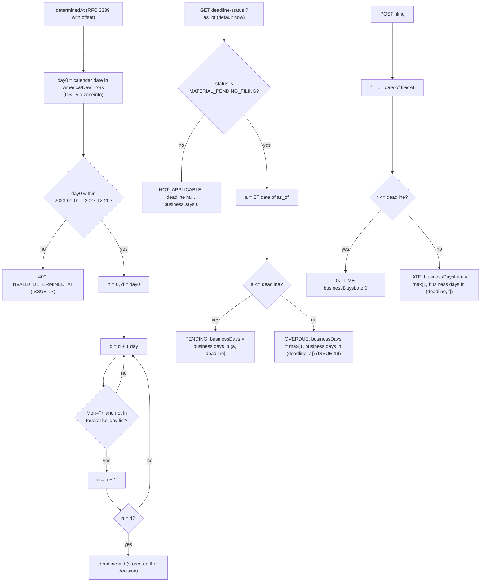
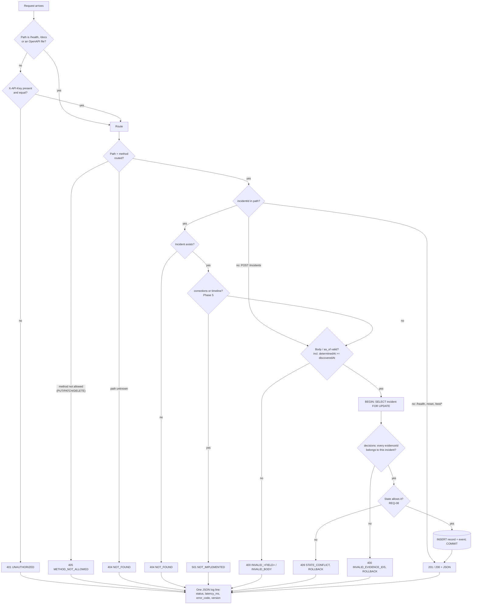

# IncidentClock — system models (as delivered, Phase 4)

These models describe the code in this repository at the Phase 4 increment. A box appears
only if the matching component exists in code; planned Phase 5 elements are drawn dashed
and labelled "planned". GitHub renders the Mermaid blocks directly.

Source of truth for each model:

| Model | Type | Derived from |
|---|---|---|
| M1 Incident status | State machine | `status_of()` + `record_decision()`/`record_filing()` state checks in `app/db.py`; Phase 2 Model 1, REQ-08 |
| M2 Information model | ER / schema | `app/schema.sql` (tables, keys, checks, triggers) |
| M3 Deadline calculation | Activity | `app/deadline.py` (`filing_deadline`, `deadline_status`, `days_late`) |
| M4 Request check order | Activity | `_observe` middleware + handlers in `app/main.py`; 409 inside the Store transaction |
| A1 Architecture & data flow | Component | `app/`, `tester/`, `frontend/` modules; `render.yaml`; Phase 2 Q7.1 |
| T1 Cross-team test session | Sequence | `tester/main.py`, `/test/*` routes in `app/main.py`; course testing interface |

---

## A1 — Architecture and data flow (component)

**Responsibilities retained outside the system:** materiality judgment (disclosure committee),
filing on EDGAR, and API-key distribution to the pod (shared out of band; the tester holds keys
only for targets registered in its `TARGETS` setting).

---

## T1 — Cross-team test session (sequence, as implemented)

---

## M1 — Incident status (state machine, as implemented)

Status is never stored; `status_of()` derives it from the current decision and whether a
filing exists (Phase 2 Q3.3). The 409 rules are REQ-08, checked after validation inside the
same transaction as the insert, so a rejected request changes nothing.

---

## M2 — Information model (ER, as implemented in `app/schema.sql`)

Invariants enforced by the database, not only the application:
- `BEFORE UPDATE OR DELETE` triggers on all six project tables raise an error (REQ-07).
- `decision_evidence` references `evidence (seq, incident_seq)`, so a decision cannot cite
  another incident's evidence even if the application check were removed (REQ-05).
- `decisions.deadline` is non-null exactly when the decision is MATERIAL; the date is computed
  once by `app/deadline.py` and stored, so a later holiday-list change cannot move it.
- One filing per incident (`UNIQUE incident_seq`).
- `POST /reset` uses `TRUNCATE ... RESTART IDENTITY`, which bypasses row triggers (REQ-14).

`test_sessions` is not cleared by `POST /reset` or `/test/setup`, so a session ID can never be reused.

---

## M3 — Deadline calculation and status (activity, as implemented in `app/deadline.py`)

Day 0 is the determination date even when it is a weekend or holiday (AC-10: Saturday Oct 4,
2025 → Thursday Oct 9). Holiday list: `fixtures/holidays.json`.

---

## M4 — Request check order (activity, as implemented)

Every 400 precedes every 409 (ISSUE-03): field validation runs before the transaction, and the
evidence-ownership check runs inside it, after the incident row is locked but before the state
check. The lock serializes concurrent decisions and filings on one incident, so the state that was
checked is the state the insert commits against.
