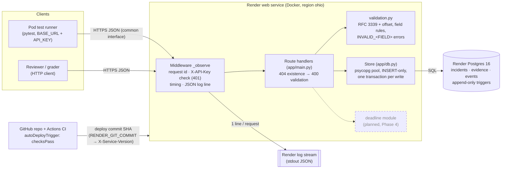
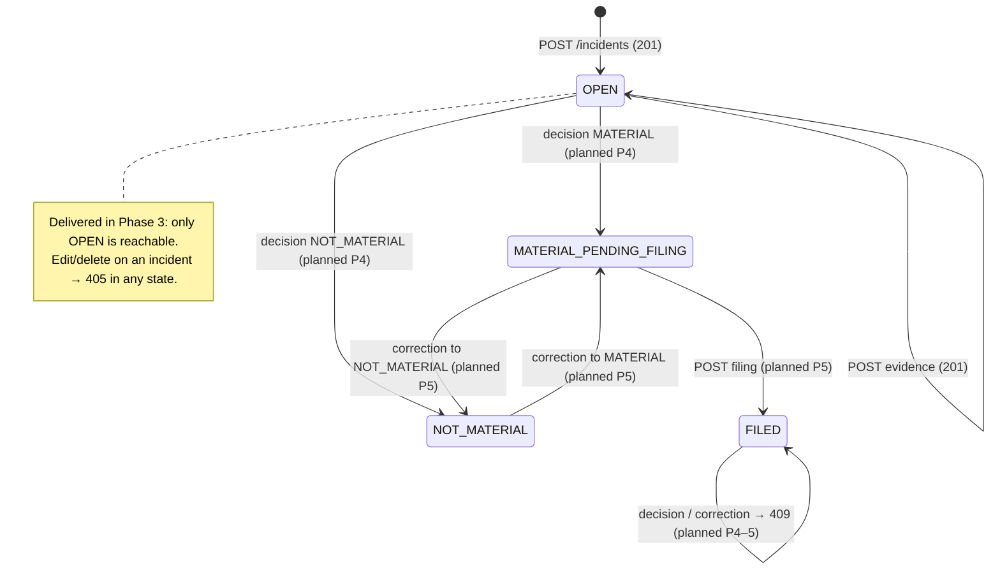
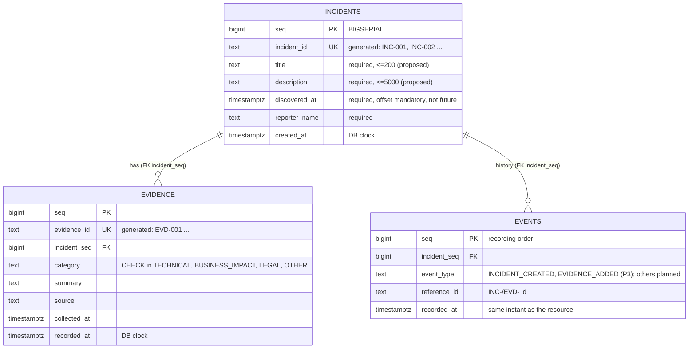
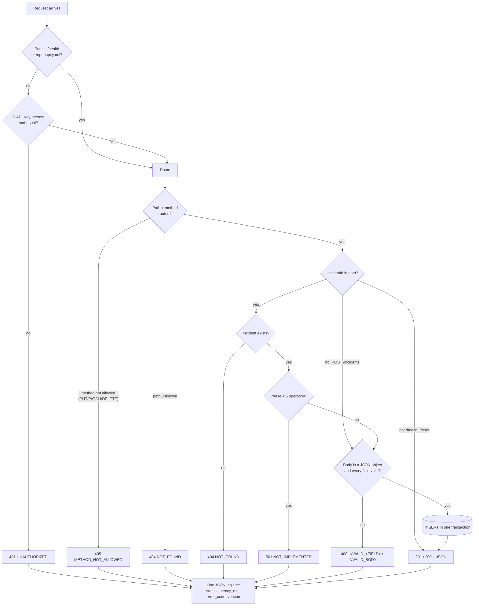

# IncidentClock — system models (as delivered, Phase 3)

These models describe the code in this repository at the Phase 3 increment. A box appears
only if the matching component exists in code; planned Phase 4–5 elements are drawn dashed
and labelled "planned". GitHub renders the Mermaid blocks directly.

Source of truth for each model:

| Model | Type | Derived from |
|---|---|---|
| M1 Incident status | State machine | `derive_status()` in `app/main.py`; Phase 2 Model 1 |
| M2 Information model | ER / schema | `app/schema.sql` (tables, keys, checks, triggers) |
| M3 Deadline calculation | Activity | Phase 2 Model 3 — **not yet implemented** (Phase 4) |
| M4 Request check order | Activity | `_observe` middleware + handlers in `app/main.py` |
| A1 Architecture & data flow | Component | `app/` modules; `render.yaml`; Phase 2 Q7.1 |

---

## A1 — Architecture and data flow (component)

**Responsibilities retained outside the system:** materiality judgment (disclosure committee),
filing on EDGAR, and API-key distribution to the pod (shared out of band).

---

## M1 — Incident status (state machine)

Status is never stored; it is derived from the current decision and filing (Phase 2 Q3.3).
In Phase 3 no decision or filing can exist, so every incident is `OPEN`.

---

## M2 — Information model (ER, as implemented in `app/schema.sql`)

Invariants enforced by the database, not only the application:
- `BEFORE UPDATE OR DELETE` triggers on all three tables raise an error (REQ-07).
- `POST /reset` uses `TRUNCATE ... RESTART IDENTITY`, which bypasses row triggers and restarts
  ID numbering (REQ-14). It is the only removal path.
- Evidence cannot reference a missing incident (FK).

Planned (not in code yet): `decisions` (with `supersedes` link for corrections, REQ-06) and `filings`.

---

## M3 — Deadline calculation (activity) — planned, Phase 4

Not implemented in Phase 3. The rule agreed in Phase 2 is unchanged: take the Eastern Time
calendar date of `determinedAt` as day 0; count forward, skipping Saturdays, Sundays and dates
on the pod's shared holiday list; the 4th counted day is the deadline (Form 8-K Gen. Instr. B.1).

---

## M4 — Request check order (activity, as implemented)

409 (state conflicts) will sit between the 400 check and the write once decisions exist (Phase 4).
